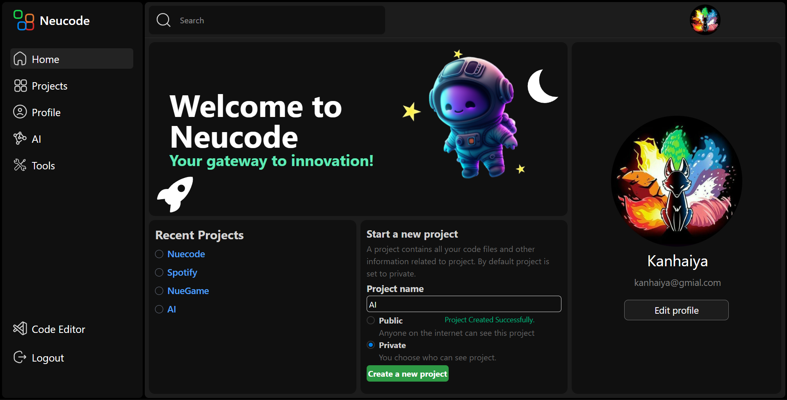
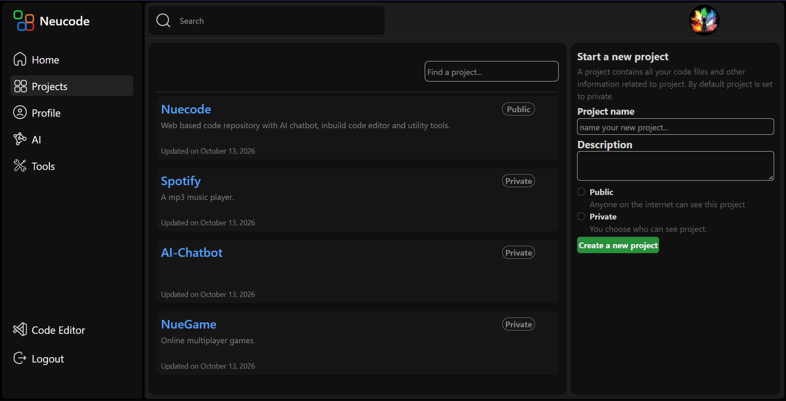
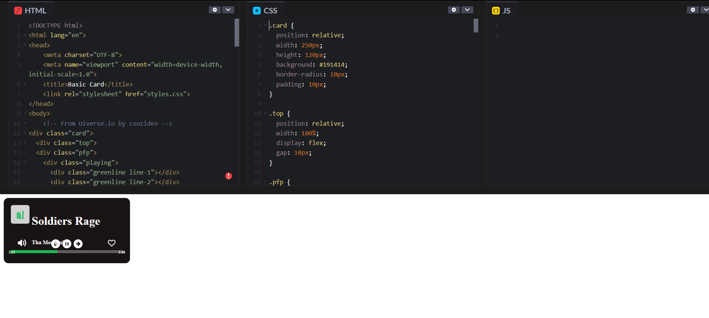
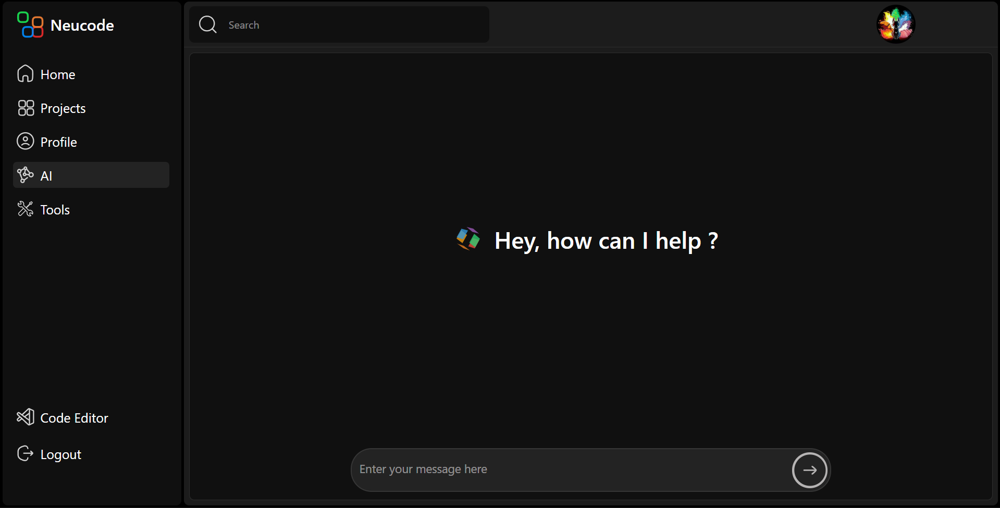
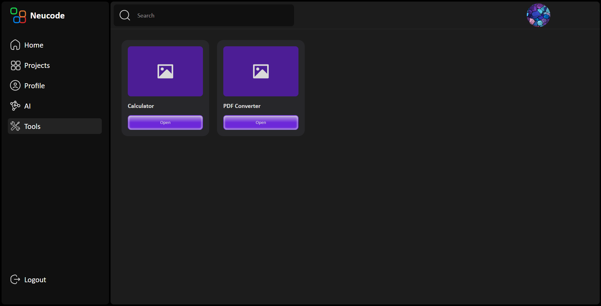
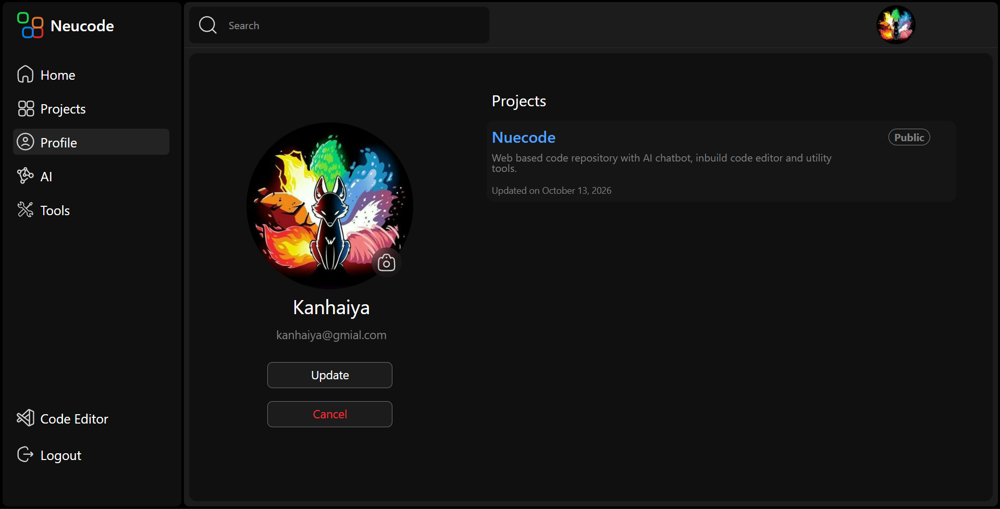
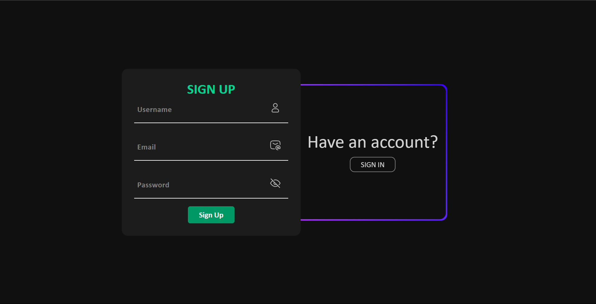
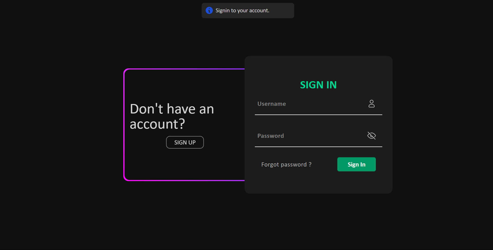

- https://img.shields.io/badge/Work%20In%20Progress-8A2BE2
  "🚀 This project is currently under active development. I am working on polishing the frontend, responsiveness and finalizing backend integrations."

# ✨ Nuecode

## Overview

Nuecode is a Full-stack, GitHub-inspired web application built using **MERN Stack**. It provides developers with a centralised workspase to create, manage, and store projects with custom repository management, an integrated web-based code editor, utility developer tools, and an AI assistant.

## Features

- 📁**Repository & Project anagement:** Create public or private projects, manage source files,and track recent work directly from your dashboard.
  
- 💻**Web-Based Code Editor:** Edit and manage web project code directly in your browser with real-time feedback.
  
- 🤖**Built-in AI Assistant:** Access an integrated AI chatbot tailored to assist with coding, debugging, and ideation.
  
- 🛠️**Developer Utility Tools:** Access custom tools designed to assist in your daily web development workflow.
  
- 🐛**User Profiles & Authentication:** Secure profile management, personalized user dashboard, and access control for private projects.
  

## Technologies Used

- **Frontend:** React.js, HTML5, CSS3/Tailwind CSS, JavaScript
- **Backend:** Node.js, Express.js
- **Database:** MongoDB
- **State & Authentication:** JSON Web Tokens (JWT) / Session Auth
   
